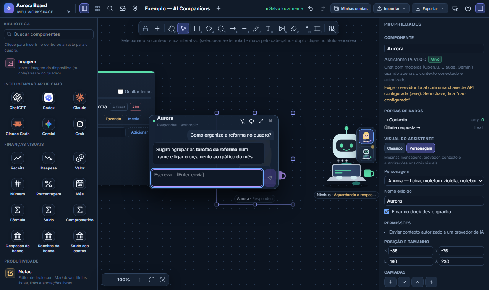

# AI Companions (issue #13)

O assistente de IA pode aparecer como um **personagem** pequeno e vivo no quadro, com **mini chat** e **dock lateral** — sem virar outro chat. É o mesmo bloco `aurora.ai`: mesmo id, mesmas mensagens (`AIData.messages`), provedor, modelo, contexto, autorizações e fluxo de aprovação de ações.

*Captura com IA simulada e dados sintéticos.*

## Usar

- Selecione um **Assistente IA** → Propriedades → **Visual do assistente**: **Clássico** ou **Personagem**; escolha o **personagem**, o **nome exibido** e **Fixar no dock deste quadro**. Trocar o visual não altera histórico, `widgetType`, id, conexões nem autorizações (e entra no desfazer).
- **Personagem no canvas:** clique para abrir o mini chat (Enter envia, botão **Parar** cancela, Esc fecha). Arraste pelo rótulo do nome ou pelas bordas para mover; o personagem e o balão não iniciam arrasto nem pan por acidente.
- **Balão:** quando uma resposta real chega com o mini chat fechado, a última resposta aparece resumida acima do personagem (código vira “[código]”); o mini chat mostra tudo (Markdown, “mostrar tudo”).
- **Conversa completa:** botão ⤢ no mini chat — abre o **mesmo componente do modo clássico** num diálogo (contexto, autorização, propostas com prévia e aprovação, limpar conversa).
- **Dock:** assistentes fixados no **quadro ativo**, presos à lateral livre (respeita Biblioteca/Propriedades redimensionáveis, barra superior e zoom). Clique abre o mini chat de qualquer ponto do quadro; no mini chat: **Ir para o assistente**, **Desafixar**, **Conversa completa**, fechar. Indicadores: aguardando (amarelo pulsando), **nova resposta** (amarelo), erro (vermelho).

## Estados (sempre ligados a fatos reais)

| Estado | Quando | Visual |
|---|---|---|
| idle | standby | respiração discreta, piscar; microanimações raras: olhar, cabelo, pé, postura, olhar o notebook, digitar, pegar a caneca |
| attention | ponteiro/foco no personagem ou mini chat aberto | inclina a cabeça, olha para o usuário |
| thinking | `sendChat` pendente | notebook aceso, mãos digitando, “…”; **sem progresso falso nem streaming** (a API devolve a resposta inteira) |
| replying | a resposta acabou de chegar (2,4 s) | aceno curto e balão |
| error | erro, cancelamento, provedor não configurado | cabeça baixa, “!”, texto do erro no mini chat (`role="alert"`) |
| unread | resposta chegou sem ninguém olhando | ponto amarelo até abrir a conversa |

A máquina de estados é pura (`src/core/companion.ts`: `visualState`, prioridade pensando > erro > respondendo > não lida > atenção > idle) e testada.

## Arquitetura

- **Controlador único** `src/integrations/aiChat.ts`: estado de requisição por assistente (sending/error/cancelled/repliedAt/unread) num módulo, fora dos componentes. Bloco clássico, personagem, dock e conversa completa usam `sendAIMessage`/`cancelAIRequest`/`useAIRequest`. Desmontar o bloco (fora da tela), trocar o visual ou abrir/fechar o mini chat **não cancela nem duplica** a conversa; um segundo envio durante um pendente é recusado.
- **Mesmo contexto e segurança:** cada envio recalcula `contextSources` → `buildContextText` → `buildSystemPrompt` com o estado atual — as mesmas funções, com `financialTaint` e as concessões locais de bancos/HTML. Estar no dock **não autoriza nada**: consulta bancária sem concessão continua fora do prompt (teste unitário).
- **Lugar certo:** trocar de quadro ou excluir o assistente aborta o pedido pendente; a resposta nunca é gravada em outro quadro/assistente.
- **Cancelamento desde o início** (apontamento P2 do PR #19): o `AbortController` nasce ANTES da descoberta do provedor (`fetchAIStatus`) e é a identidade do pedido. Descoberta e envio são abortáveis — **Parar** age na hora, mesmo que a rede ignore o sinal. Antes de enviar e antes de gravar o controlador confere: pedido atual, não cancelado, mesmo quadro, assistente existe. Um pedido abandonado (troca de quadro, exclusão, excluir + desfazer com o mesmo id) não recria estado, não chama o provedor e não grava nada; uma resposta tardia de um pedido cancelado nunca afeta o pedido seguinte.
- **Ações propostas** nunca são aplicadas pelo mini chat nem ao clicar no balão: o mini chat mostra “N ação(ões) proposta(s): revisar e aprovar na conversa completa”.
- **Moldura dinâmica:** `WidgetPlugin.frameFor(data)` (novo, opcional) escolhe `bare` no visual Personagem e `standard` no Clássico.

## Dados e compatibilidade

- Campo **opcional** `AIData.companion = { v: 1, displayMode, preset, name, docked }`, saneado na importação. **Ausente = clássico**: backups antigos importam intactos e continuam clássicos, sem ganhar o campo. `SCHEMA_VERSION` não mudou. Nenhum payload de animação no JSON (o desenho vem do código).
- Fixação no dock vive no próprio assistente → escopo por quadro, desfazer/refazer coerentes, excluir o assistente remove a referência (sem órfãos).
- **Preferências pessoais** (configuração local `companionPreferences`, fora de quadros e backups): Animações **Sistema** / Desligadas / Discretas / Normais / Expressivas; dock Esquerda / Direita / Oculto; sons desligados; falas de ambientação desligadas (quando existirem, serão frases fixas locais, nunca respostas da IA).

## Personagens (presets)

`src/companions/presets.tsx` — manifesto `CharacterPreset { id, name, description, colors, hair, poses, micro }` + desenho SVG por partes nomeadas (`c-head`, `c-eyes`, `c-pupils`, `c-hair`, `c-hand-l/r`, `c-screen`, `c-mug`, `c-foot`, `c-badge-*`). Presets originais e genéricos: **Aurora** (loira, moletom violeta, notebook e caneca), **Sol** (cabelo cacheado, tons quentes), **Nimbus** (robô verde-água). Personagem é independente do provedor. Preset desconhecido → avatar estático com iniciais.

**Por que SVG + CSS:** sem rede nem dependência nova, nítido em qualquer zoom, animação só de `transform`/`opacity` (GPU), trocável por preset sem tocar no chat. Conjuntos futuros (sprites, Lottie) podem implementar o mesmo contrato de poses/microações.

## Desempenho e acessibilidade

- Animações só por CSS, acionadas por atributos (`data-state`, `data-micro`); o React não re-renderiza por quadro.
- Microanimações por timer aleatório controlado (Discretas 14–30 s, Normais 8–18 s, Expressivas 4,5–10 s), nunca a mesma ação seguida; **paradas** com aba oculta (`visibilitychange`), fora da tela (o canvas desmonta), “Desligadas” ou movimento reduzido no padrão “Sistema”.
- **Até 6 personagens animando ao mesmo tempo**; os demais ficam estáticos com chat funcional. O dock usa retratos estáticos.
- Standby **nunca chama a API** (E2E: 8 personagens por 3 s → 0 requisições).
- Mini chat: `role="dialog"`, foco no campo ao abrir e devolvido ao fechar, Esc fecha; `aria-live="polite"` só para resposta final/erro; botões com nome; alvos grandes no toque (testado no Pixel 7).
- **Conversa completa é modal** (apontamento P2 do PR #19, `src/ui/useModalFocus.ts`): foco entra no diálogo ao abrir, Tab/Shift+Tab ficam contidos, foco perdido para o `<body>` volta, Esc fecha só o diálogo e o foco volta ao personagem/dock do assistente (o mini chat que abriu já não existe). Backspace fora de campo não volta a página (o WebKit navegava). O guarda de `useKeyboard` bloqueia os atalhos do quadro com a conversa completa, o Command Center, a captura, o checkpoint ou qualquer `[aria-modal="true"]` abertos — Delete nunca exclui o assistente atrás do diálogo.

## Testes

- `tests/unit/companion.test.ts` — dados/compatibilidade, preferências, máquina de estados, microanimações.
- `tests/unit/ai-chat.test.ts` — mesmo histórico, sending → idle, não lida, sem duplicidade, dois assistentes isolados, cancelar, troca de quadro, erro, contexto autorizado × não autorizado, banco bloqueado no dock; cancelamento e concorrência durante a descoberta do provedor (cancelar, trocar de quadro, excluir, excluir + desfazer, duplicado, resposta tardia, provedor que ignora o sinal).
- `e2e/ai-companions.spec.ts` (IA simulada) — personagem/mini chat, dock, não lida, dois assistentes, erro, propostas exigem aprovação, standby sem API e limite de animação, movimento reduzido + compatibilidade + desfazer, inspetor; J: conversa completa modal (foco, Tab contido, Delete/setas/ferramentas/Ctrl+D/Ctrl+A sem efeito, foco perdido volta, Esc, foco devolvido); `e2e/mobile.spec.ts` — toque no personagem e dock.

## Fora desta entrega

Streaming real, voz/sons, outros provedores (nada de Grok), agente autônomo, dock global entre quadros e arrastar entre dock e canvas.
