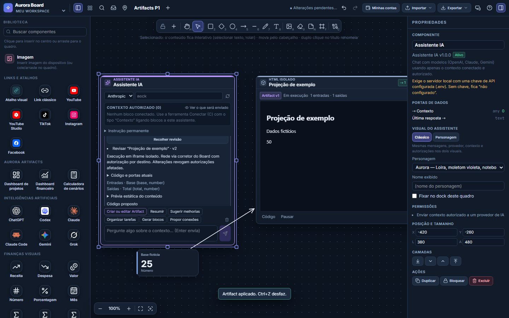

# Aurora Artifacts P1

## ADR — Runtime, autorização e persistência

A base auditada é `7d9e083` (`main`, PR #41). A cópia local foi clonada limpa. Os PRs abertos #3, #4, #6 e #7 tratam de dependências de CI. As issues #42 e #43 priorizam o fluxo de revisão no Assistente IA e o refinamento no canvas.

A ação estruturada atual já tem prévia, confirmação, aplicação por `applyBatch` e histórico por quadro. O widget `aurora.sandbox-html` já oferece iframe de origem opaca, CSP própria, portas tipadas, persistência de preferências e um corretor de GET HTTPS com consentimento local. O Data Hub fornece páginas limitadas e agregações do conjunto inteiro em saídas distintas. O Electron usa o mesmo frontend via `aurora://app` com IPC validado no processo principal. O importador marca HTML como inativo, mesmo quando o arquivo declara autorização prévia.

O Artifact é uma evolução opcional dos dados de `aurora.sandbox-html`. A proposta v3 tem escopo separado do chat convencional. O provedor recebe o pedido, metadados de portas escolhidas e, quando autorizado para aquele envio, o código da revisão selecionada. O host guarda o escopo da resposta em memória e revalida a revisão, as portas e o grafo na confirmação. A aplicação usa `applyBatch`, com revisão recuperável no próprio widget e permissões locais vinculadas à configuração. Código e conexões são inspecionáveis no host antes da execução.

O sandbox é a fronteira de acesso ao host. A autorização para executar é distinta da autorização de rede e do compartilhamento com IA. Mensagens precisam apresentar a origem opaca, a janela e o token da execução. A CSP e o isolamento de origem limitam acesso, mas um loop síncrono pode monopolizar o processo do iframe ou do canvas conforme a plataforma. A recuperação deve funcionar ao reabrir em modo seguro.

Sequência de implementação: contrato e plano puro, integração do Assistente e do widget, recuperação e exemplos, testes e homologação.

## Uso no canvas

1. Adicione ou abra um **Assistente IA**, escolha um provedor configurado e clique em **Criar ou editar Artifact**.
2. Escolha **Novo Artifact** ou selecione um HTML existente. No refinamento, confira o código e as portas que serão compartilhados e marque a autorização para este envio.
3. Descreva o painel. Para propor conexões tipadas, marque até oito alvos em **Blocos para conectar**. O provedor recebe os metadados desses alvos. Os valores ligados serão entregues ao Artifact localmente.
4. Clique em **Gerar proposta**. A revisão mostra o código, as portas, as conexões propostas e uma amostra estática do conteúdo. Use **Salvar pausado** para guardar o rascunho ou **Aplicar e executar** para autorizar o JavaScript. **Descartar proposta** encerra a revisão.
5. No canvas, use **Código** para editar manualmente, **Pausar** para interromper o painel e **Histórico** para restaurar uma versão como nova revisão pausada. Dê duplo clique no título para renomear. Use os controles do canvas para mover e redimensionar, e **Propriedades** para consultar portas e rede.

Experimente “Crie um dashboard de projetos com contagem por status, prioridade e filtros. Comece com dados fictícios identificados.” Para refinar o painel, selecione-o no Assistente e peça “Mantenha as entradas e inclua um gráfico de barras por prioridade”.

### Exemplos locais

Abra **Biblioteca → Aurora Artifacts**. Cada exemplo entra pausado. **Ver código** mostra o HTML completo e **Ativar** pede autorização para executá-lo.

| Exemplo | Demonstração |
|---|---|
| Dashboard de projetos | Indicadores, filtros de status e prioridade e gráfico SVG. Pode receber `tarefas` do bloco Tarefas ou `rows` do Data Hub. Nesse segundo caso, os indicadores cobrem a página mostrada |
| Dashboard financeiro | Receitas, despesas, saldo e meta. Ligue dois blocos de Valor configurados como dinheiro às portas `receitas` e `despesas`. `saldoCalculado` indica se as entradas permitem usar a saída `saldo` |
| Calculadora de cenários | Valor base e taxa editáveis, ativo localmente, com portas `resultado` e `valido`. Ligue `resultado` a uma Fórmula para consumir o valor calculado |

O Data Hub fornece `rows` para a página e calcula `summary.stats` e `groups` sobre o conjunto completo. Um exemplo reativo pode ligar `rows` a uma porta `object` para listar linhas e ligar `summary` a outra para mostrar o total global.

## Formato e histórico

O código atual continua em `data.html`. Entradas e saídas continuam em `data.bridge` versão 1 e usam o [contrato da ponte HTML](HTML_DATA_BRIDGE.md). As preferências usam `data.state`. `data.artifact` versão 1 registra número da revisão, ID aleatório, origem e data. As últimas cinco revisões guardam o código e as portas da época. Restaurar gera outra revisão com portas validadas contra as conexões atuais. Os backups comuns do Board levam esse formato e reabrem o código como pausado em importações. Os quadros locais reabrem com a decisão de execução que foi gravada.

O [contrato v3](AI_ACTIONS.md#aurora-artifacts-contrato-v3) aceita até 14 ações, 12 entradas e 12 saídas, 32 mil caracteres de HTML, 1.500 elementos estáticos e 80 mil caracteres de resposta. Uma proposta aplica no máximo um painel e suas conexões. As ações v1 e v2 do chat convencional continuam disponíveis. Identidade, geometria e conexões compatíveis são preservadas na edição. O host recusa a revisão inteira se ela desviar conexões existentes, adicionar cabos incompatíveis, repetir uma conexão ou formar um ciclo.

## Autorizações e recuperação

- **Envio ao provedor.** A prévia de código é texto do host vinculado à revisão e ao provedor. Autorize cada envio de edição. O controlador exclui o histórico convencional, as entradas, o estado, os datasets e os resultados bancários do pedido v3. O escopo de aplicação expira ao reabrir o quadro. As respostas de Artifact são excluídas da saída `reply` e do contexto de conversa convencional.
- **Execução.** O host valida HTML em um template inerte e retorna diagnósticos de forma e tamanho. A amostra do host renderiza elementos estáticos sem atributos ou scripts. A execução interativa usa o iframe isolado com a CSP existente. A validação estática tem alcance limitado sobre o comportamento dinâmico do JavaScript.
- **Fluxo e rede.** `aurora.onInputs` recebe entradas tipadas. `aurora.publish` valida e transmite saídas temporárias. `aurora.setState` guarda preferências de execuções sem fontes protegidas. `aurora.request` usa o [corretor HTTPS](HTML_NETWORK_BRIDGE.md) com consentimento por destino e autorização adicional para fontes protegidas. Código, portas e conexões do Artifact revogam os acessos do Artifact. Desfazer restaura o conteúdo e mantém esses acessos revogados.
- **Falhas.** O runtime exibe diagnóstico genérico para erros observados sem copiar a mensagem ou o stack para o host. Se a inicialização não responde em cinco segundos após o carregamento do iframe, o host responsivo pode desligá-lo. O canvas mantém o limite de 20 iframes ativos e só monta os que estão em vista.
- **Modo seguro.** Na web, abra o Board com `?safe`. No desktop, reabra com `--safe-artifacts`; o diálogo nativo de janela travada também dá a opção **Reabrir sem HTML**. Pause ou restaure o painel no modo seguro antes de voltar à sessão normal. Um loop síncrono pode bloquear o renderer inteiro. Nesse caso, feche o processo e reabra em modo seguro. O watchdog JavaScript depende de o host continuar responsivo.

## Arquivos modificados

| Área | Arquivos |
|---|---|
| Modelo e contrato | `src/core/artifact.ts`, `src/core/widgetData.ts`, `src/integrations/aiActions.ts`, `src/integrations/artifactActions.ts` |
| Assistente | `src/integrations/aiChat.ts`, `src/widgets/builtin/ai.tsx`, `src/widgets/builtin/aiArtifact.tsx` |
| Companions | `src/ui/companions/MiniChat.tsx`, `src/ui/companions/CompanionCharacter.tsx` |
| Widget, rede e persistência | `src/widgets/builtin/sandbox.tsx`, `src/widgets/builtin/artifactExamples.ts`, `public/sandbox.html`, `src/net/broker.ts`, `src/net/policy.ts`, `src/persistence/importBudget.ts`, `desktop/main.ts` |
| Verificação | `tests/unit/artifact-actions.test.ts`, `e2e/artifacts.spec.ts`, `e2e-desktop/integrations.spec.ts`, `e2e-desktop/harness.ts` |

## Homologação

| Verificação | Evidência |
|---|---|
| Contrato e histórico | Seis testes unitários de esquema, permissões, conexões, atomicidade, preservação da geometria, importação e histórico |
| Chromium | Quatro cenários P1 cobrem geração e edição simuladas, confirmação e cancelamento, portas, atualização de dados, histórico, persistência, edição manual e recuperação. O CSV de três linhas mantém o total global em 80 quando a troca de página muda o subtotal de 30 para 50 |
| Interação e compatibilidade | A execução focada de Artifacts, aceite do canvas e AI Companions aprovou 26 testes |
| Desktop Windows | 19 testes aprovados e três skips de configuração. O novo teste confere ativação, isolamento da API desktop e do Node, resultado editável e reabertura em modo seguro |
| Desktop Linux | A execução local no contêiner Playwright foi interrompida pela falta de espaço no host Windows. O job desktop da CI do PR executa o mesmo cenário em Linux |
| Dependências | `npm run audit:prod` retornou zero vulnerabilidades |

### Evidência visual

Capturas do Chromium em 1440 × 900, tema padrão e dados fictícios. Os testes Playwright também anexam as capturas ao relatório.

- [Artifact em execução após restauração](img/p1-artifact-em-execucao.png)
- [Dashboard de projetos com filtro de prioridade](img/p1-dashboard-de-projetos.png)
- [Dashboard financeiro com duas entradas conectadas](img/p1-dashboard-financeiro.png)
- [Calculadora de cenários publicando o resultado para uma fórmula](img/p1-calculadora-de-cenarios.png)

## Escopo do próximo incremento

A Epic #42 e a especificação #43 permanecem abertas. Modo expandido, biblioteca avançada, exportação individual, diff de revisões, mockups dos modos expandido e biblioteca, runtime React/TypeScript, dependências de terceiros, publicação e integrações externas ficam para incrementos posteriores. A homologação de geração com provedores reais depende de credenciais autorizadas. Os testes de geração desta entrega usam um provedor simulado.
