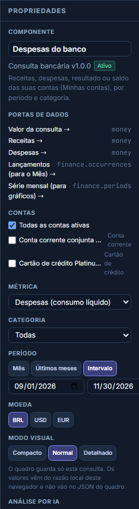
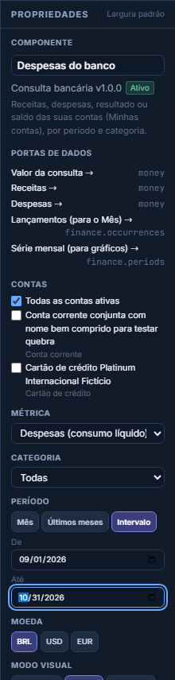
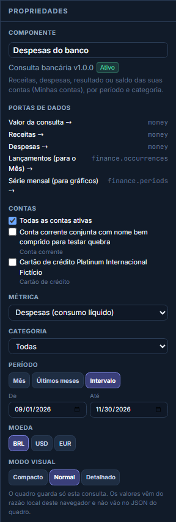
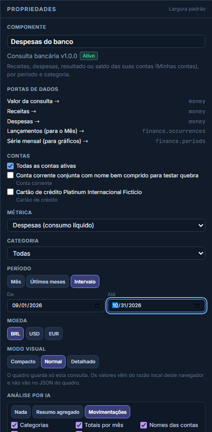
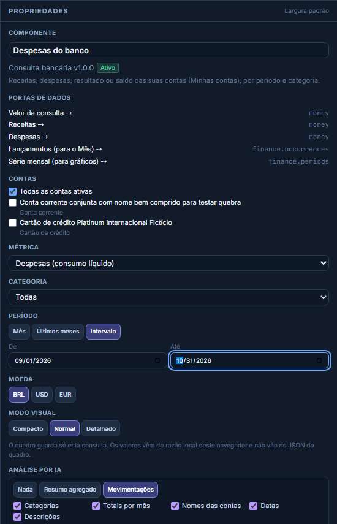

# Laterais redimensionáveis e formulários de Propriedades (issue #10)

## Uso

- **Arraste a borda interna** da Biblioteca (esquerda) ou de Propriedades (direita). O cursor vira `↔` e a largura muda na hora. O texto não é selecionado durante o arrasto, e os blocos HTML não capturam o ponteiro.
- **Teclado:** foque a alça com Tab e use ←/→ para mudar 16 px, Shift+←/→ para 64 px, Home para a largura mínima e End para a máxima. **Enter** ou **duplo clique** restaura a largura padrão.
- **Restaurar:** quando a largura não é a padrão, o cabeçalho da lateral mostra “Restaurar largura padrão” (Biblioteca) ou “Largura padrão” (Propriedades).
- As larguras ficam salvas **neste navegador** e valem para todos os quadros.

## Larguras reais de antes

As classes `w-64`/`w-72` são em `rem`, e a raiz do app usa `font-size: 13px`. Por isso as laterais tinham na prática **208 px** (Biblioteca) e **234 px** (Propriedades), não 256/288 como se supunha. Os padrões novos são em **pixels**, 256/288, como pede a issue. Propriedades ganhou 54 px por padrão, e o canvas perde ~100 px em relação a antes; ainda dá para estreitar até 220 px.

## Regras

| | Biblioteca | Propriedades |
|---|---|---|
| Padrão | 256 px | 288 px |
| Mínimo / máximo | 220 / 650 px | 220 / 650 px |

- O canvas mantém pelo menos **360 px** entre as laterais. Se a janela estreitar, as laterais encolhem sem perder o valor salvo, que volta a valer quando houver espaço.
- **Modo compacto (≤ 899 px):** as laterais continuam sobrepostas ao canvas, com fundo escurecido e fechamento por toque fora. Não há alça, e a largura fica limitada a 85% da janela. Não existe arrasto em telas de toque, para não atrapalhar a rolagem.
- **Persistência:** chave `panelWidths` nas configurações locais (IndexedDB `aurora-board`, área `kv`), a mesma das preferências de zoom e de GIFs. A largura **não** vai para o JSON do quadro nem para o backup do workspace. Um valor adulterado é saneado ao carregar: lixo vira o padrão, e valores fora da faixa ficam limitados a 220–650 px e à janela.
- **Acessibilidade:** a alça tem `role="separator"`, `aria-orientation="vertical"`, `aria-valuemin`, `aria-valuemax`, `aria-valuenow` e `aria-valuetext`, além de rótulo próprio e foco visível.
- **Nada no quadro muda:** só a interface. A área do canvas é recalculada pelo `ResizeObserver` já existente, então cliques, seleção, zoom e coordenadas do mundo usam a área real (há teste E2E para isso). O painel **Locais** passou a se ancorar à direita da Biblioteca, qualquer que seja a largura dela.

## Formulários responsivos

- Em `.props-form` (corpo de Propriedades), campos, selects e áreas de texto têm `min-width: 0` e `max-width: 100%`, e textos longos quebram por palavra. Não há rolagem horizontal nem controle cortado.
- **Portas de dados:** o tipo desce para a linha de baixo quando não cabe ao lado do nome.
- **Consulta bancária:**
  - Nome da conta em várias linhas, com o tipo abaixo.
  - Intervalo de datas em grade adaptativa: lado a lado quando cabe, empilhado quando não cabe, com rótulos “De”/“Até”.
  - Mês, ano e quantidade quebram de linha.
  - Opções de envio à IA em grade adaptativa.
- **Biblioteca:** a grade de componentes se adapta à largura (`auto-fill`, mínimo de 72 px por item).
- Os inspetores de todos os widgets são verificados por E2E na largura mínima (220 px): nenhum controle passa das bordas do painel.

## Antes e depois (dados fictícios)

| Antes (234 px, a largura real) | Depois (220 px) | Depois (288 px) | Depois (420 px) | Depois (550 px) |
|---|---|---|---|---|
|  |  |  |  |  |

Antes, o campo “Até” passava 41 px da borda (rolagem horizontal), os nomes das contas eram cortados e o tipo da conta se espremia ao lado. As capturas são geradas por `AURORA_DOC_SHOTS=1 npx playwright test e2e/panels.spec.ts --project=chromium`.

## Testes

- `tests/unit/panels.test.ts` (7): saneamento, limites pela janela, modo compacto, ações e gravação fora do quadro.
- `e2e/panels.spec.ts`:
  - Arrastar cada alça muda só a sua lateral, sem seleção de texto, e o canvas acompanha.
  - Limites e canvas mínimo, inclusive ao estreitar a janela.
  - Teclado e ARIA.
  - Persistência, restauração e valor adulterado descartado.
  - A largura não vai para o backup.
  - Desenho e clique por coordenadas do mundo depois de redimensionar; Locais ancorado.
  - Consulta bancária sem cortes em 220, 288, 420 e 550 px.
  - Todos os widgets em 220 px.
  - Modo compacto.
