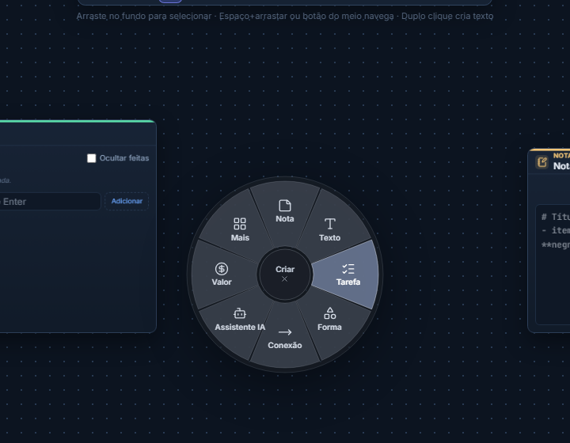

# Aurora Wheel — menu radial de criação (issue #15)

Segure o **botão direito** num espaço vazio do quadro: surge uma roda cinza translúcida em oito fatias. Mova até uma fatia e solte — o item nasce **exatamente no ponto onde você segurou**, já selecionado. Clique direito normal continua abrindo o menu de contexto de sempre.

## Gestos

| Gesto | Resultado |
|---|---|
| Clique direito curto (área vazia ou elemento) | Menu de contexto tradicional, uma única vez |
| Segurar o direito ≥ 220 ms em área vazia | Abre a roda (o menu antigo não pisca) |
| Segurar e arrastar > 12 px antes dos 220 ms | Abre a roda na hora (gesto rápido) |
| Soltar sobre uma fatia | Executa a fatia |
| Soltar no centro **sem** ter passado por uma fatia | A roda fica aberta (modo clique e teclado) |
| Soltar no centro depois de passar por uma fatia, ou longe do anel (> 220 px) | Cancela |
| Clique no centro, fora da roda, `Esc`, perder o foco da janela | Cancela, sem alterar o quadro |
| Segurar o direito sobre elemento, widget, campo, editor ou iframe | Nada muda: menu tradicional (ou o menu nativo do campo) |

A roda só abre com **mouse** (`pointerType === 'mouse'`), com a ferramenta **Seleção** ou **Mão**, sem texto/widget em edição, sem seta multiponto em curso e sem diálogo aberto. Caneta, toque e Ctrl+clique do Mac seguem o comportamento anterior.

### Por que o `contextmenu` nativo não abre o menu num gesto rastreado

O evento `contextmenu` chega no **down** no Linux e no macOS e no **up** no Windows (nos três motores). Por isso a decisão não depende dele: no gesto rastreado o evento é sempre engolido (`preventDefault`), chegue antes ou depois, e o menu tradicional é aberto pelo **up** de um clique curto. Se o evento não chegar em 600 ms após soltar, a espera é descartada (sem engolir o próximo clique). Um único timer por gesto, limpo em up, `pointercancel`, `blur`, troca de ferramenta, Esc e desmontagem — a lógica vive num módulo (`src/canvas/radialGesture.ts`), não num componente, então o Strict Mode não duplica timers.

## Fatias padrão

| # | Fatia | Ação (APIs existentes) |
|---|---|---|
| 1 | **Nota** | nota adesiva 200×200 centrada no ponto, em edição (`addElements` + `startTextEdit`) |
| 2 | **Texto** | texto no ponto, em edição (`createTextAt`; vazio é descartado, como hoje) |
| 3 | **Tarefa** | widget `aurora.tasks` (`addWidget`) |
| 4 | **Forma** → Retângulo, Elipse, Losango, Frame | tamanho padrão do clique sem arrastar (160×100; frame 480×320) |
| 5 | **Conexão** → Seta, Linha, Conectar | só **ativa a ferramenta** (nada degenerado é criado) |
| 6 | **Assistente IA** | widget `aurora.ai` |
| 7 | **Valor** | widget `aurora.value` |
| 8 | **Mais** | lista pesquisável de todos os widgets e variações da biblioteca (Consulta bancária, HTML, Fórmula, Gráfico…), Imagem e “Personalizar a roda” |

Cada criação é **uma** entrada de desfazer. A câmera não se move para abrir a roda; perto das bordas o desenho se desloca para caber na área visível, mas o item continua no ponto original.

## Teclado e acessibilidade

- **W** abre a roda no ponto do mouse sobre o quadro (ou no centro) com a primeira fatia focada. O botão **+ (Aurora Wheel)** da barra de ferramentas faz o mesmo (alternativa para toque e teclado).
- Setas / Tab circulam (sentido horário), **Enter**/**Espaço** ativam, **1–8** escolhem direto, **Esc** volta do submenu ou fecha, **Backspace** volta. O foco volta para onde estava ao fechar.
- `role="menu"` com `menuitem` reais (botões com nome “Nota: Nota adesiva aqui, já em edição”), `aria-haspopup` nos submenus, descrição do teclado em `aria-describedby`; a lista “Mais” é um `combobox` + `listbox`.
- A roda nunca é o único caminho: tudo continua na barra de ferramentas, na biblioteca e no menu de contexto.
- `prefers-reduced-motion`: sem animação de abertura. Sem `backdrop-filter`, o disco continua legível (fundo 78% opaco).

## Personalização (favoritos)

Painel **Propriedades** sem seleção → **Aurora Wheel**: até 8 fatias, cada uma escolhida entre os itens nativos e os widgets disponíveis no registro; **Restaurar padrão** volta às 8 fatias acima. Gravado nas configurações locais (`radialFavorites`), **fora** dos quadros e dos backups. Ao carregar, itens desconhecidos ou de widgets removidos são descartados, repetidos são ignorados, o mínimo é 3 e **“Mais” é sempre mantido** (a roda não pode esconder o acesso aos demais itens).

## Implementação

- `src/core/radial.ts` — puro: `sectorAt` (ângulo com 0 no topo, horário; zona neutra de 34 px; anel até 118 px; direção vale até 220 px), `sectorPath` (SVG), `placeMenu` (cabe na área visível), `sanitizeFavorites` e `holdReducer` (máquina de estados do gesto).
- `src/canvas/radialGesture.ts` — timer, captura do `contextmenu`, abertura dos menus.
- `src/store/radialActions.ts` — o que cada item faz, favoritos.
- `src/ui/RadialMenu.tsx` — SVG + botões HTML; nenhuma biblioteca nova.

## Fora desta entrega

- **Radial contextual** sobre elementos selecionados (duplicar, conectar, bloquear…): o menu tradicional, inclusive os itens de plugins, continua sendo o caminho para comandos avançados.
- **Toque (long press)**: não implementado — conflita com pan, pinça e seleção por toque; o botão **+ (Aurora Wheel)** na barra é a alternativa testada no celular.
