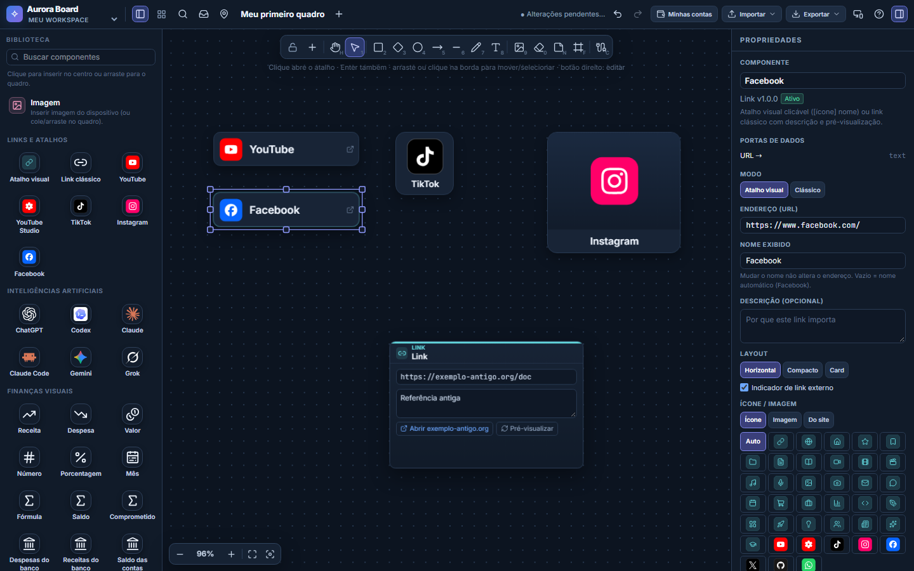

# Smart Links — atalhos visuais (issue #22, ciclo L1)

Cole um endereço no quadro e ganhe um bloco **`[ÍCONE] Nome`** que abre o destino com um clique, sem URL,
campos ou caixas de texto no canvas. Nome, endereço, ícone/imagem e layout ficam no painel **Propriedades**.
Vale para qualquer site: redes sociais, painéis, editores, referências.



## Resumo de decisões

| Decisão | Motivo |
|---|---|
| **Mesmo widget** `aurora.link`, com campo opcional `visual` | Não cria uma segunda base de links. `url`, `description` e `preview` continuam iguais — backups antigos dependem deles. |
| **Sem `visual` = Clássico** | Quadros e backups anteriores abrem idênticos (campos no bloco). Nenhuma migração e nenhuma mudança de `schemaVersion`. |
| Inserção nova e **URL colada** começam como Atalho Visual horizontal | É o fluxo pedido. O nome inicial vem de uma tabela **local** de sites conhecidos (YouTube Studio, YouTube, TikTok, Instagram, Facebook, X, GitHub, WhatsApp) ou do domínio — nada é buscado na rede. |
| Moldura `bare` decidida pelos dados (`frameFor`) | O atalho desenha a área inteira; o modo Clássico mantém a moldura padrão. |
| Clique decidido pelo **canvas**, não pelo bloco | O atalho não é `<a>` nem botão no DOM (isso roubaria o arrasto). O controlador do canvas distingue clique de arrasto e pergunta ao plugin o que fazer (`WidgetPlugin.clickAction`). |
| Ícones **locais**: lucide (ISC) + Simple Icons (CC0) | Sem favicon automático, sem CDN, sem Google S2. Mesmo SVG na tela e na exportação. |
| Imagem enviada vira **asset local** (`putAsset`), referenciada por `assetId` | Nada de base64 em `board.elements[].data`; entra no backup pelo pipeline existente. |
| Imagem remota da pré-visualização só com **opt-in persistente**, removido na importação/colagem externa | Respeita S1-SEC-011: abrir um quadro não avisa terceiros sem consentimento dado neste navegador. |

## Modelo de dados

```ts
interface LinkData {
  url: string; description: string; preview: LinkPreview | null;   // formato histórico, intocado
  visual?: {
    version: 1;
    displayMode: 'classic' | 'shortcut';
    layout: 'horizontal' | 'compact' | 'card';
    label: string;            // nome exibido (≤ 120); vazio = automático
    iconMode: 'local' | 'uploaded' | 'preview';
    iconId: string;           // ícone local; vazio = automático pelo domínio
    assetId: string;          // imagem enviada (a_…); nunca base64
    fit: 'cover' | 'contain';
    showLabel: boolean;       // compacto: nome abaixo (false = só ícone)
    showExternal: boolean;    // horizontal: indicador ↗
    remoteImageConsent?: { at: number; src: string };  // só a imagem https exata autorizada
  };
}
```

Saneamento (`sanitizeVisual`, `src/core/smartLinks.ts`): `visual` que não é objeto é ignorado (bloco fica
Clássico); enums fora do domínio voltam ao padrão; `label` perde caracteres de controle e é cortado em 120;
`iconId` e `assetId` inválidos viram vazio; campos desconhecidos são descartados. `sanitize` é idempotente.

### Nome exibido

`label` → título do bloco (se não for o padrão “Link”/“Atalho”) → site conhecido → domínio → “Configurar link”.
Editar o nome em Propriedades **não altera a URL**. O título do bloco (camadas, busca) acompanha o nome só
enquanto ainda era automático; um título dado à mão nunca é sobrescrito.

## Usar

- **Criar:** cole uma URL `http(s)://` no canvas, ou use a biblioteca → **Links e atalhos** (Atalho visual,
  Link clássico, YouTube, YouTube Studio, TikTok, Instagram, Facebook). Atalho sem endereço mostra
  “Configurar link”; clicar nele **não abre nada** e leva ao campo de URL nas Propriedades.
- **Abrir:** clique no centro do atalho, **Enter** com ele selecionado, ou botão direito → “Abrir link”.
  Sempre em nova aba com `noopener,noreferrer`.
- **Selecionar sem abrir:** clique na borda (faixa de 8 px de tela), Shift/Ctrl+clique, seleção por área,
  ou segurar o clique/toque por mais de 600 ms. O cursor vira mãozinha só onde o clique abre.
- **Mover/redimensionar:** arrastar (qualquer movimento acima de 3 px é arrasto e não abre) e as alças da
  seleção, como qualquer bloco. Bloquear o atalho o transforma num botão fixo que ainda abre.
- **Editar:** botão direito → “Editar atalho”, ou selecionar e usar o painel Propriedades: modo, URL,
  nome exibido, descrição, layout, ícone/imagem, encaixe, **Abrir link** e **Pré-visualizar**. Erros de URL
  aparecem no inspetor; no bloco, um link inválido fica com borda tracejada e não abre.
- **Converter:** Propriedades → Modo, ou botão direito → “Converter…”. A conversão é reversível e preserva
  URL, descrição e pré-visualização. Trocar modo/layout adota o tamanho de referência mantendo o centro
  (horizontal 240×56, compacto 96×104 ou 72×72 só ícone, card 220×200, clássico 320×210).

Por que não duplo clique para editar? O primeiro clique já abriria o site. O duplo clique abre **uma** aba
(cliques repetidos em até 700 ms são um só) e a edição fica no menu de contexto e no painel.

## Ícones e imagens

| Fonte | Como funciona | Rede |
|---|---|---|
| **Ícone** (padrão) | 30 ícones genéricos (lucide) + 8 marcas (Simple Icons). “Auto” escolhe pelo domínio; fallback: globo. | Nenhuma |
| **Imagem** | PNG, JPEG ou WebP até 2 MB, validados **pelos bytes** (`checkImageBytes`) e pelas dimensões. Guardada com `putAsset`. Na exibição, os bytes são conferidos de novo (um backup pode apontar o `assetId` para outra coisa). | Nenhuma |
| **Do site** | Usa a imagem da pré-visualização Open Graph obtida com “Pré-visualizar” (servidor local, proteção SSRF existente). Só aparece depois de “Exibir imagem de *host*”; o opt-in fica gravado e pode ser revogado. | Só após opt-in |

GIF e SVG enviados ficam fora da v1: GIF animado exigiria o pipeline de animação do ciclo 6 em miniatura, e
SVG em `` é seguro mas complica a validação de dimensões e a exportação. A limitação está testada
(arquivo que não é PNG/JPEG/WebP é recusado com mensagem).

Favicon: a infraestrutura existente (`/api/link-preview`) não devolve favicons, e buscá-los no navegador
contactaria terceiros. A alternativa local é o ícone automático por domínio.

Imagem ausente (backup sem o asset, outro navegador) ou inválida: o atalho usa o ícone e o inspetor avisa;
nada quebra.

## Privacidade e segurança

- **Nenhuma chamada externa automática.** Colar, criar, abrir o quadro ou configurar não contacta sites.
  Os E2E falham se qualquer requisição sair do localhost.
- **Abrir:** `linkTargetUrl` aceita só `http:`/`https:` com host, sem usuário/senha embutidos, até 2048
  caracteres. `javascript:`, `data:`, `file:`, `blob:`, `about:` são recusados. HTTP é aceito (links clássicos
  já abriam http), com aviso no inspetor. Nunca há navegação ao montar/renderizar.
- **Opt-in de imagem remota não atravessa backups:** a importação (`parseImport`) e a colagem externa removem
  `remoteImageConsent`, como o `blockActiveContent` faz com HTML. Duplicar no mesmo navegador mantém.
- **O opt-in é da imagem, não do bloco:** guarda a URL exata autorizada (`src`, só https). Se a imagem da
  pré-visualização mudar por qualquer caminho — URL trocada no modo Clássico, nova pré-visualização — o atalho
  volta ao ícone e o inspetor pede nova confirmação (apontamento do Codex no PR #23).
- **IA, busca e resumo:** o resumo automático (`summarize`, usado no contexto de IA e na exportação genérica)
  leva só `origem + caminho` — query, fragmento e credenciais são omitidos (`redactUrl`). A busca (#14) indexa
  nome exibido, domínio e descrição, nunca a URL. A porta de dados `url:text` continua entregando a URL
  completa: é uma conexão explícita do usuário.
- **Exportação:** PNG/SVG usam `exportSVG` com o mesmo layout da tela (fundo, ícone local ou imagem enviada,
  nome escapado, indicador). Imagem remota nunca entra na exportação (vira o ícone) — sem rede e sem “canvas
  contaminado”.

## Integração

- **Histórico/autosave:** todas as edições passam por `updateElements`/`commit` (desfazer/refazer, coalescência
  ao digitar o nome).
- **Copiar/colar/duplicar:** os dados são copiados inteiros; a imagem é compartilhada pelo `assetId`.
- **Backup:** `assetIdsOf` inclui `visual.assetId`; um backup sem o arquivo gera aviso na importação.
- **Dataflow:** saída `url:text` inalterada.
- **Menu radial (#15):** a roda só abre no fundo; botão direito curto no atalho abre o menu de contexto.

## Pontos de extensão (genéricos)

- `WidgetPlugin.clickAction(data, element)` — ação de um clique consciente num widget `bare`. O canvas decide
  o gesto (botão principal, sem modificadores, sem arrasto, fora da faixa da borda, antes do toque longo);
  Enter no widget selecionado executa a mesma ação.
- `WidgetPlugin.exportSVG` pode devolver `null` para usar o resumo genérico (ex.: Link no modo Clássico).
- A barra de dicas passou a usar `frameFor` (moldura conforme os dados), o que também corrige a dica dos
  assistentes-personagem (#13).

## Arquivos

| Arquivo | Papel |
|---|---|
| `src/core/smartLinks.ts` | Modelo, saneamento, política de URL, sites conhecidos, nome exibido, privacidade, layout |
| `src/widgets/builtin/link.tsx` | Widget (Clássico + Atalho), inspetor, presets, exportação, abertura |
| `src/widgets/builtin/linkIcons.ts`, `linkIconNodes.ts` | Catálogo local de ícones (gerado do lucide instalado) |
| `src/assets/link-icons/` | SVGs de marca (Simple Icons, CC0) e procedência |
| `src/canvas/controller.ts` | `clickableWidgetAt`, `runWidgetClick`, limiar de toque longo |
| `tests/unit/smart-links.test.ts`, `e2e/smart-links.spec.ts`, `e2e/mobile.spec.ts` | Testes |

## Testes

- Unitários (`tests/unit/smart-links.test.ts`): compatibilidade e idempotência, saneamento hostil, conversão
  reversível com desfazer/refazer, política de URL, resumo sem query, busca, sites conhecidos, política de
  nome, revogação do opt-in na importação, assets no backup, duplicação, ícones limpos, layouts em tamanhos
  extremos, faixa de clique, exportação SVG, gesto (clique, arrasto, Shift, borda, toque longo, botão direito,
  duplo clique, inválido/vazio, bloqueado, outra ferramenta) e colagem sem `fetch`.
- E2E (`e2e/smart-links.spec.ts`, Chromium/Firefox/WebKit): colar → `[ícone] YouTube Studio`; uma aba por
  clique; arrastar/Shift/borda/redimensionar não abrem; duplo clique abre uma; Enter e menu; Propriedades
  (URL perigosa recusada no inspetor, nome sem alterar URL, ícone, card, upload PNG, arquivo falso recusado,
  desfazer/refazer, reload, backup com asset, importação, asset ausente); link antigo Clássico e conversão
  reversível; quatro redes com layouts mistos; busca; SVG. Todos verificam que nada saiu do localhost.
- Celular (`e2e/mobile.spec.ts`): toque abre uma aba; toque longo seleciona; arrastar com o dedo move.
